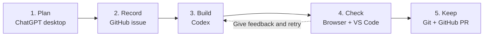

# Working with AI

Make one small improvement to a working app: **explain the limit below the Note box**.

The small change lets you practice the whole cycle: agree on a plan with AI, inspect its edits, try the result, and keep a clear record in GitHub. You are learning to guide and check AI, not just ask it for code.

**You are responsible for the result.** ChatGPT helps you plan; Codex edits the local files. You decide whether the work matches the request.

By the end, you should be able to:

- Agree a small scope and examples with AI before coding.
- Inspect a diff and use tests plus browser checks to judge the result.
- Link a requirement to its issue, implementation, and checks.



[See the before/after and visual overview](https://kaw393939.github.io/218_spec/). Get ready below, then follow the five-step assignment.

## 1. Get your copy

Use your class setup: **ChatGPT desktop, Codex, VS Code, Git with GitHub SSH access, and Node.js 24** (22.13+ works). Keep using the SSH setup from class. No API key is needed. Missing a tool? Use [Setup help](https://kaw393939.github.io/218_spec/setup.html).

On [the starter](https://github.com/kaw393939/218_spec), choose **Use this template → Create a new repository**. Select your account, name it `ai-practice`, choose **Public**, and leave **Include all branches** unchecked. If that name is taken, choose another name and use it in the commands below.

In your class terminal, go to the folder where you keep projects. Clone **your copy using SSH**. Replace `YOUR-USERNAME` (and the repository name if different):

```sh
git clone git@github.com:YOUR-USERNAME/ai-practice.git
cd ai-practice
git remote -v
code .
```

`git remote -v` should show `git@github.com:YOUR-USERNAME/ai-practice.git` for both fetch and push, with your actual username and repository name. If `code .` is unavailable, use **VS Code → File → Open Folder** and select the folder you just cloned. Already cloned your copy? Open that folder instead of cloning again.

## 2. Try the app

In that folder:

```sh
npm ci
npm start
```

Open the address printed in the terminal. You should see **“Keep something useful.”** with Link and Note fields, **without** an explanation of the note limit. Save a link you want to revisit and a note about why. Leave this terminal running.

The instructions website is separate from this local app. If a command fails or port 3000 is occupied, use [Setup help](https://kaw393939.github.io/218_spec/setup.html#common-fixes).

Open this same folder as a **local project in Codex**. Keep using the same folder in VS Code and both terminals. [Local project help](https://learn.chatgpt.com/docs/projects#use-local-projects-for-folders-and-codebases).

Open a second terminal, `cd` into this project folder, and check your Git setup:

```sh
pwd
git config user.name
git config user.email
git push --dry-run origin main
```

Expect your project path, your Git name/email, and `Everything up-to-date`. If anything is missing or rejected, use [Setup help](https://kaw393939.github.io/218_spec/setup.html) before continuing. Do not force-push.

## 3. Make your first change

Continue to **[Your first change](https://kaw393939.github.io/218_spec/practice.html)**. That is the rest of the assignment: plan → issue → edit → check → pull request.

The task is in `docs/specs/practice.md`; the HTML is in `app/public/index.html`. Keep `main` as your starting point and do the change on the branch named in the exercise. Your issues and PRs belong in **your copy**.

You are done when your PR is merged, its issue is closed, and the spec links to your code and actual checks. Your copy runs build checks; no GitHub Pages deployment is required.

[Worked example](https://kaw393939.github.io/218_spec/example.html) · [Optional background](https://kaw393939.github.io/218_spec/background.html) · [Website maintenance](docs/contributing.md)
